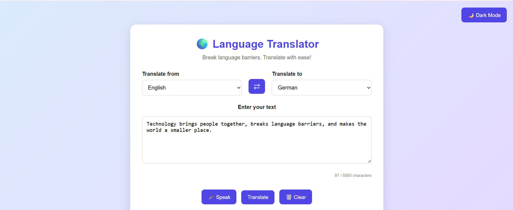
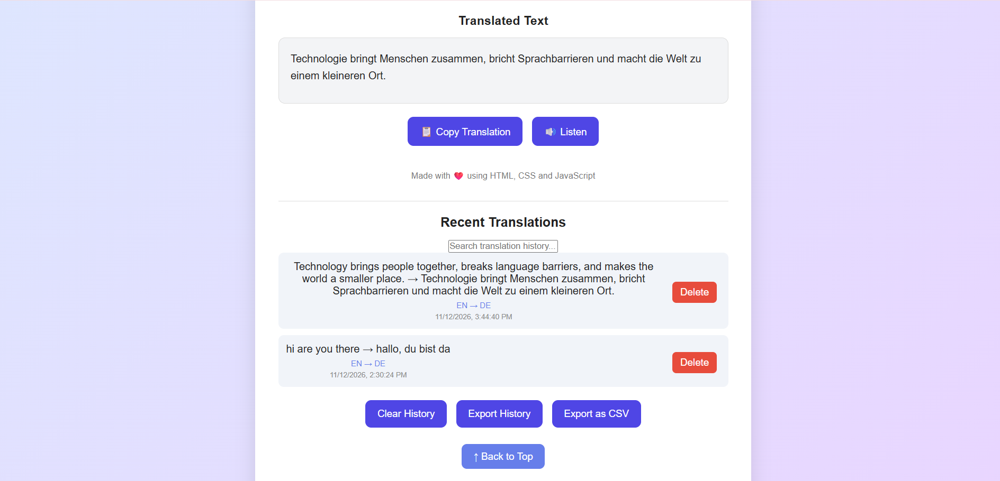
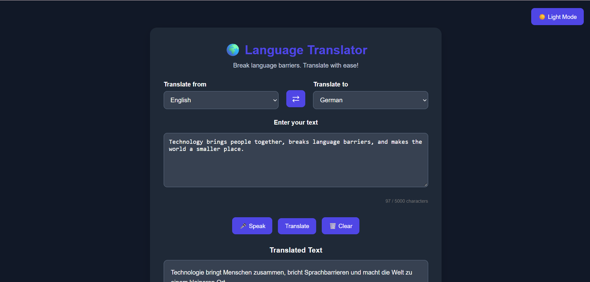

# 🌐 Language Translator – Web Application

A web-based language translator that helps users translate text between multiple languages through a simple and user-friendly interface.

## 🚀 Live Demo

[Open Language Translator](https://language-translator-h5p2.onrender.com)

## ✨ Features

- Translate text between English, German, Hindi, French and Spanish.
- Swap source and target languages.
- Copy translated text.
- Clear text with one click.
- Voice input and text-to-speech support.
- Translation history with search and delete options.
- Export translation history.
- Dark mode.
- Character counter.
- Responsive design for different screen sizes.

## 🛠️ Technologies Used

- HTML – Website structure.
- CSS – Styling and responsive design.
- JavaScript – Interactive functionality.
- Node.js – Backend runtime.
- Express.js – Backend server.
- LibreTranslate – Translation service.

## 💻 Run Locally

1. Clone this repository:

   ```bash
   git clone https://github.com/BASAVVA-jpg/Language-Translator.git
   ```

2. Open the project folder:

   ```bash
   cd Language-Translator
   ```

3. Install dependencies:

   ```bash
   npm install
   ```

4. Start the server:

   ```bash
   npm start
   ```

5. Open your browser and visit:

   ```text
   http://localhost:3000
   ```

## 🎯 Project Purpose

This project was developed to practice frontend development, backend integration, API usage, JavaScript programming and web application deployment.

## 👩‍💻 Developer

Developed as a Computer Science Engineering student project.

## 📸 Screenshots

### 1. Main Translator


### 2. Translation History


### 3. Dark Mode

